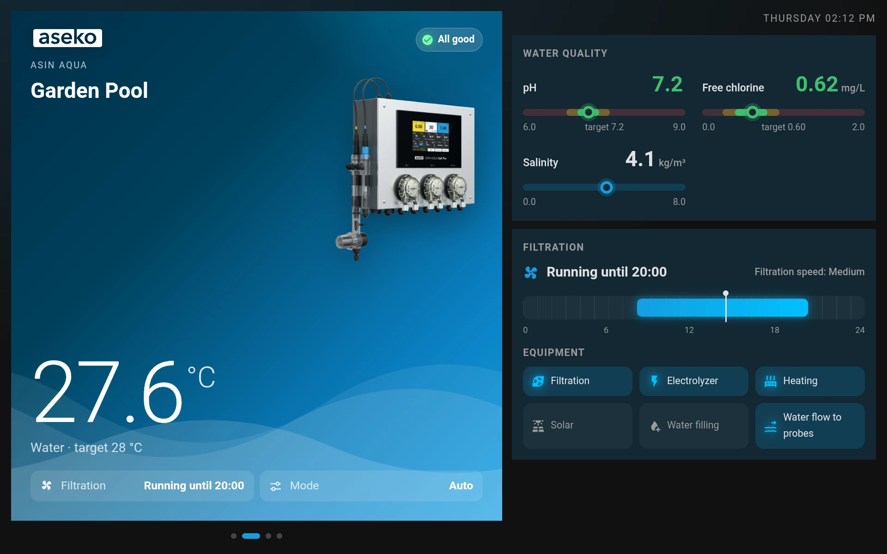
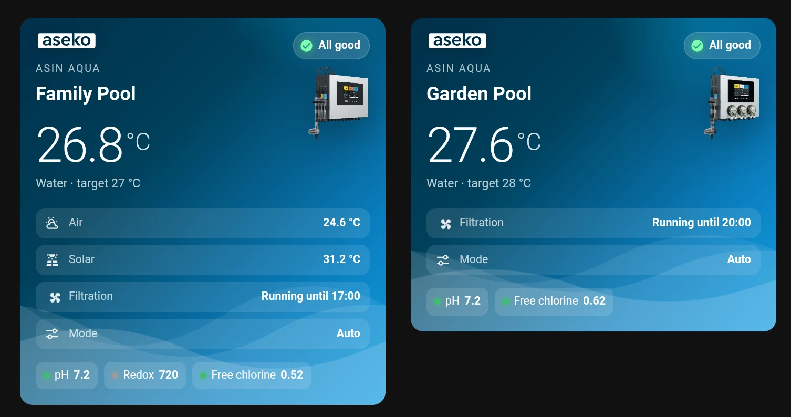
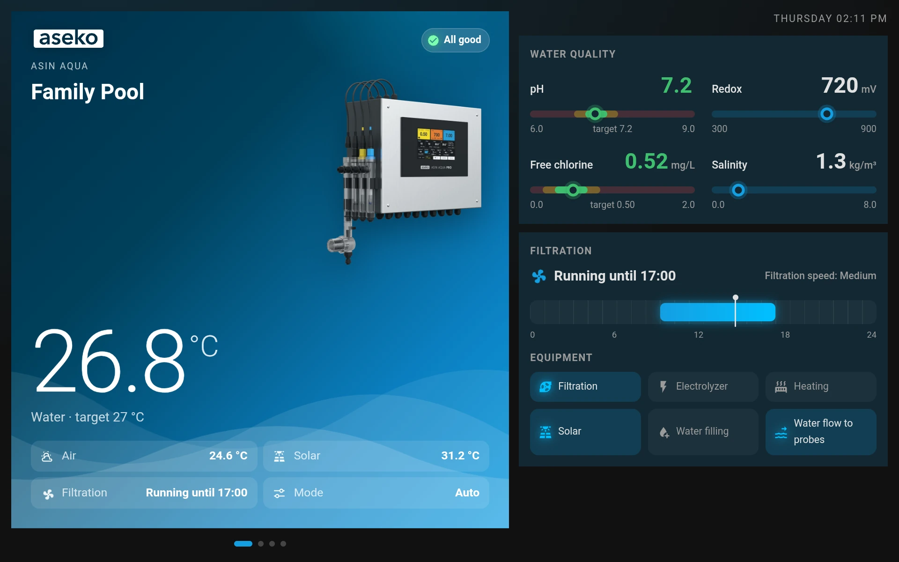
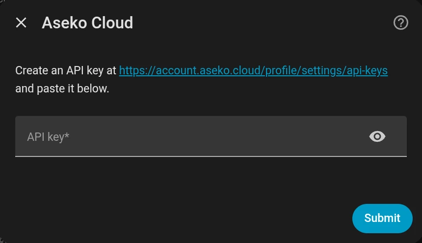
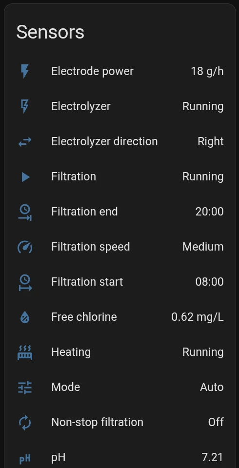

# Aseko Cloud for Home Assistant

[](https://hacs.xyz)
[](https://github.com/dkk54/ha-aseko-cloud/releases)
[](https://www.home-assistant.io)
[](https://github.com/dkk54/ha-aseko-cloud/actions/workflows/validate.yml)

The official Aseko integration for Home Assistant. It brings Aseko pool units
(ASIN AQUA and ASIN Pool) into Home Assistant using the public
[Aseko integrator API](https://api.aseko.cloud/api/v1/docs). It is a custom
integration, installed through HACS.



<table>
  <tr>
    <td width="50%"></td>
    <td width="50%"></td>
  </tr>
</table>

The pool dashboard in the screenshots comes with the integration; see
[Pool dashboard](#pool-dashboard).

## Features

- Every pool unit on your Aseko account becomes a device in Home Assistant,
  with a photo of the unit.
- Water temperature and quality (pH, redox, chlorine, salinity) next to the
  target values set on the unit.
- Filtration: whether it runs, its schedule and speed; heating, solar,
  electrolyzer and water filling.
- A **Problem** sensor that turns on when the unit reports an error, with the
  messages as attributes, ready for notifications.
- A ready-made [pool dashboard](#pool-dashboard), including a full-screen
  showcase for a wall tablet or TV.
- Units you pair later in the Aseko app appear on their own within minutes.
- A reminder 14 days before your API key expires.

## Requirements

- Home Assistant **2025.3** or newer.
- An Aseko account with your units paired in the Aseko app.
- An Aseko API key (see [Get your Aseko API key](#4-get-your-aseko-api-key)).
- If Aseko needs something from you before the API can be used, such as
  accepting new Terms of Service or a subscription that includes API access,
  Home Assistant tells you so under **Settings → Repairs**, with a link to fix
  it.

## Supported units

Every unit paired with your Aseko account works. Each unit gets the sensors
for the values it measures, so a unit without a redox probe, for example, has
no redox sensor.

Units of these product families also get a photo: ASIN AQUA Home, Home Pro,
Net, Net+, Oxygen, Pro, Profi, Salt, Salt Net, Salt Pro, Eox and Eox Pro, and
ASIN Pool.

## Installation

There are two ways to install:

1. **[HACS](#1-via-hacs-recommended)** — recommended; handles updates for you.
2. **[Manual install](#2-manual-install)** — no HACS needed.

Either way, you'll finish by [adding the integration](#3-add-the-integration-in-home-assistant)
and pasting an [Aseko API key](#4-get-your-aseko-api-key).

### 1. Via HACS (recommended)

[](https://my.home-assistant.io/redirect/hacs_repository/?owner=dkk54&repository=ha-aseko-cloud&category=integration)

**Don't have HACS yet?** HACS is a separate add-on you install once. Follow the
official guide at <https://hacs.xyz/docs/use/download/download/>, then restart
Home Assistant before continuing here.

1. In Home Assistant, open **HACS** in the sidebar (or click the badge above).
2. Search **Aseko Cloud**, open it, and click **Download** (confirm the version
   when prompted).
3. **Restart Home Assistant** — *required*. The integration only appears in the
   **Add integration** picker after a restart.
4. Continue with [Add the integration](#3-add-the-integration-in-home-assistant).

### 2. Manual install

No HACS required. You need file access to your Home Assistant `config/` folder
(via Samba, the *File editor* / *Studio Code Server* add-on, SSH, etc.).

1. Open the [Releases](https://github.com/dkk54/ha-aseko-cloud/releases) page,
   download the source code ZIP of the latest release and unzip it. (Avoid
   **Code → Download ZIP** on the repository page: it contains unreleased
   changes.)
2. Copy the **`custom_components/aseko_cloud/`** folder into your Home Assistant
   **`config/custom_components/`** directory. The result must be:
   ```
   config/custom_components/aseko_cloud/__init__.py
   config/custom_components/aseko_cloud/manifest.json
   …
   ```
   (Create the `custom_components` folder first if it doesn't exist.)
3. **Restart Home Assistant.**
4. Continue with [Add the integration](#3-add-the-integration-in-home-assistant).

### 3. Add the integration in Home Assistant

Same final steps no matter how you installed:

1. Go to **Settings → Devices & services → Add integration**.
2. Search **Aseko Cloud** and select it. It carries the *custom integration*
   badge and asks for an **API key**.
   > ⚠️ Don't pick **"Aseko Pool Live"** — that's the separate built-in
   > `aseko_pool_live` integration and asks for **email/password**, not an API
   > key.
3. Paste your [Aseko API key](#4-get-your-aseko-api-key) and submit. Each paired
   pool unit on the account becomes its own device.

   

> **"Aseko Cloud" doesn't show up in the picker?** Two usual causes:
> 1. You didn't **restart** Home Assistant after installing — restart and retry.
> 2. **Stale browser cache** — hard-refresh the page
>    (**Ctrl/Cmd + Shift + R**) or open Home Assistant in a private window.

### 4. Get your Aseko API key

1. Sign in at <https://account.aseko.cloud/profile/settings/api-keys>.
2. Create a new API key and **copy it immediately** (it may only be shown once).
3. Paste it into the integration's setup form (step 3 above).

## Pool dashboard

The integration comes with a dashboard made for pools: every unit with its
photo, water quality against the target values, the filtration schedule,
equipment, messages and a 48-hour history, plus a full-screen showcase for a
wall tablet or TV. It finds the units of the account by itself.

1. Go to **Settings → Dashboards → Add dashboard**.
2. Pick **Aseko Pool** under *Community dashboards*, give it a name (e.g.
   *Pool*) and click **Create**.

If your Home Assistant does not list *Community dashboards* yet, pick **New
dashboard from scratch** instead, open the new dashboard, click the pencil
(**Edit dashboard**) → **⋮ → Raw configuration editor** and replace the
content with:

```yaml
strategy:
  type: custom:aseko-pool
```

Units paired later appear on the dashboard on their own. The texts follow the
language of your Home Assistant profile (English and Czech; other languages
fall back to English).

The dashboard has these views:

- **Pools:** a card for every unit. Tap a card to open the unit.
- **A view per unit:** water quality against the target values, the
  filtration schedule for today, equipment, messages and a 48-hour history.
- **Showcase:** one unit at a time in full screen, for a wall tablet or TV.
  Units take turns every 20 seconds; swipe or tap the dots to switch. Offline
  units are skipped unless all of them are offline.

### Showcase on a wall tablet or TV

To hide the Home Assistant header and sidebar, add `?kiosk` to the address of
the showcase, for example `http://homeassistant.local:8123/pool/showcase?kiosk`.
In the Home Assistant app on a tablet this happens on its own. The showcase
then scales itself to fit the screen. Tap the clock in the top right corner to
get back to the dashboard.

### Options

Optional settings under `strategy` in the raw configuration editor:

```yaml
strategy:
  type: custom:aseko-pool
  theme: my-theme        # a Home Assistant theme for the dashboard
  rotate_seconds: 30     # how long the showcase shows each unit, 20 by default
  unit_images:           # your own photos instead of the built-in ones
    ASIN AQUA: /local/my-pool-unit.png
    default: /local/my-pool-unit.png   # shown while there is no unit yet
```

`unit_images` is keyed by the device model as shown on the device page.

### Cards

The cards of the dashboard can also be used on your own dashboards: **Edit
dashboard → Add card** and search for *Aseko*. Each card shows one unit, picked
in the card's YAML by `device_id`.

## Entities

Each unit is one device. Its entity IDs follow the unit name: in an English
Home Assistant, a unit named *Pool* gets `sensor.pool_ph`,
`binary_sensor.pool_problem` and so on. Entities appear only for values the
unit reports. Entities marked *diagnostic* are listed under the device's
diagnostic section.



### Sensors

| Entity | Unit | Notes |
|---|---|---|
| Water temperature | °C | |
| Air temperature | °C | |
| Solar temperature | °C | |
| Required water temperature | °C | Diagnostic; the target set on the unit |
| pH | | |
| Required pH | | Diagnostic |
| Redox | mV | |
| Required redox | mV | Diagnostic |
| Free chlorine | mg/L | |
| Combined chlorine | mg/L | |
| Required free chlorine | mg/L | Diagnostic |
| Salinity | kg/m³ | |
| Electrode power | g/h | Salt electrolysis |
| Filter flow | m³/h | |
| Filter pressure | bar | |
| Water level | cm | |
| Mode | | Auto, Eco, Off, On, Party, Winter |
| Filtration speed | | Boost, High, Low, Medium, Off |
| Pool flow | | Overflow, Bottom |
| Water level state | | OK, Filling, Low, High |
| Electrolyzer direction | | Left, Right, Waiting |
| Filtration start | | `HH:MM` of the running or next filtration period |
| Filtration end | | `HH:MM`; unknown during non-stop filtration |

### Binary sensors

| Entity | Notes |
|---|---|
| Connectivity | Diagnostic; whether the unit is online |
| Problem | On while the unit reports an error; the `messages` attribute lists every message with its type, severity, text and detail |
| Filtration | Running |
| Non-stop filtration | On when filtration is set to run non-stop |
| Heating | Running |
| Solar | Running |
| Electrolyzer | Running |
| Water filling | Running |
| Water flow to probes | |

### Image

| Entity | Notes |
|---|---|
| Photo | A photo of the unit by its product family; empty for families without a photo and for units that were never online |

## Automation examples

Get a notification when a unit reports a problem:

```yaml
automation:
  - alias: "Pool: problem"
    triggers:
      - trigger: state
        entity_id: binary_sensor.pool_problem
        to: "on"
    actions:
      - action: notify.notify
        data:
          title: "Pool needs attention"
          message: >-
            {{ state_attr('binary_sensor.pool_problem', 'messages')
               | map(attribute='message') | join(', ') }}
```

Get a notification when pH stays out of range for half an hour:

```yaml
automation:
  - alias: "Pool: pH out of range"
    triggers:
      - trigger: numeric_state
        entity_id: sensor.pool_ph
        below: 6.8
        for: "00:30:00"
      - trigger: numeric_state
        entity_id: sensor.pool_ph
        above: 7.6
        for: "00:30:00"
    actions:
      - action: notify.notify
        data:
          message: "Pool pH is {{ states('sensor.pool_ph') }}"
```

Replace `pool` with your unit's name and `notify.notify` with your
notification service.

## How it works

- The integration reads data from the Aseko cloud every 5 minutes. Changes on
  the unit therefore show up with a delay of up to 5 minutes.
- It is read-only: it shows what the unit reports, but cannot change settings
  on the unit.
- When you unpair a unit in the Aseko app, its device is removed from Home
  Assistant. If the account suddenly reports no units at all, the devices are
  kept and shown as unavailable instead, so a glitch on the Aseko side cannot
  wipe their names, areas and dashboard references.

## Troubleshooting

**Home Assistant shows a repair about Aseko.** Open **Settings → Repairs**. A
repair explains what Aseko needs from you, such as accepting new Terms of
Service or checking your subscription, and links to where to do it. Once it is
resolved, the integration recovers on its own.

**The API key is about to expire or has expired.** Home Assistant raises a
repair 14 days before the key expires. Create a new key at
<https://account.aseko.cloud/profile/settings/api-keys> and enter it via
**Settings → Devices & services → Aseko Cloud → ⋮ → Reconfigure**. If the key
has already expired, Home Assistant asks for a new one in a reauthentication
prompt.

> The integration cannot tell which Aseko account a key belongs to, so it
> accepts a key from a different account too. Its units then replace the
> current ones: devices of units missing from the new account are removed.
> To add a second account, add the integration again instead.

**A unit shows as unavailable.** Check that the unit is online in the Aseko
app. The integration marks a unit unavailable when the Aseko cloud cannot be
reached or no longer reports the unit.

**Reporting a bug.** Please attach diagnostics and, ideally, a debug log:

1. **Diagnostics:** **Settings → Devices & services → Aseko Cloud → ⋮ →
   Download diagnostics**. The API key is removed from the file.
2. **Debug log:** on the same page choose **⋮ → Enable debug logging**,
   reproduce the problem, then **Disable debug logging** to download the log.

Then open an [issue](https://github.com/dkk54/ha-aseko-cloud/issues/new/choose).

## Contributing

See [CONTRIBUTING.md](CONTRIBUTING.md).

## License

The source code is licensed under Apache-2.0 — see [`LICENSE`](LICENSE).

The Aseko name and logo are trademarks of Aseko. The Aseko logo, the product
photos and the screenshots are owned by Aseko and are not covered by the
Apache License; see [`NOTICE`](NOTICE).
